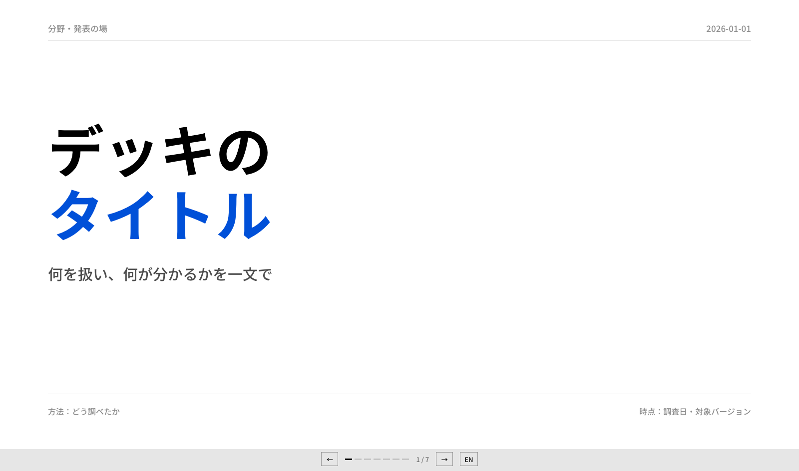
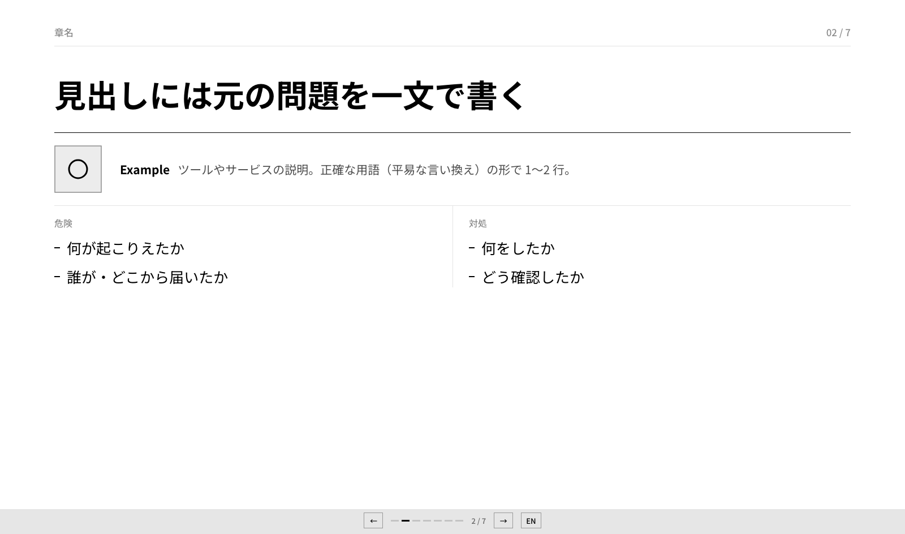

# deck-template

技術トーク・調査報告向けの HTML スライドのテンプレート。1 ファイルで動き、ビルドも依存パッケージも要らない。白・黒・グレーにアクセントの青 1 色で、構造は罫線だけで作る。

A single-file HTML slide template for technical talks and research reports. No build step, no dependencies. Japanese / English toggle with the `L` key.




## 使い方

GitHub の "Use this template" で新しいリポジトリを作るか、`template.html` と `icons/` をコピーする。

```bash
cp template.html my-talk.html
open my-talk.html
```

`<section class="slide">` を書き換えて使う。書き方とデザインの原則は [PRINCIPLES.md](PRINCIPLES.md) にある。

## 操作

| キー | 動作 |
|---|---|
| `→` `Space` `Enter` / 右半分をクリック | 次へ |
| `←` `Backspace` / 左半分をクリック | 前へ |
| `Home` `End` | 最初・最後 |
| `L` | 日本語と英語の切り替え |

URL で開き方を指定できる。`my-talk.html#s5` は 5 枚目から、`my-talk.html?lang=en` は英語で開く。

## 含まれるレイアウト

| # | レイアウト | 使う場面 |
|---|---|---|
| 1 | 表紙 | タイトル、方法、調査時点 |
| 2 | 問題 → 危険 → 対処 | 1 件 1 枚の報告。ツールの説明とアイコン付き |
| 3 | 一覧 | 比較対象をアイコンと 1 行で紹介 |
| 4 | 罫線の表 | 項目ごとの比較 |
| 5 | 大きな数字 | 結果の数値 |
| 6 | ラベル付きの図 | 仕組みの説明 |
| 7 | 手順と数式 | 付録の技術的な補足。式の下に意味を書く |
| 8 | 付録・出典 | 出典と確認日 |

## スクリーンショット

```bash
scripts/screenshot.sh my-talk.html screenshots
```

全スライドを日英両方、原寸（1600×944）と縮小がかかるサイズ（1280×800）で撮る。撮る前に `scripts/check.sh` でタグの対応を確かめる。ローカルの Google Chrome か Chromium を使い、パスは `CHROME` 環境変数で上書きできる。

## PDF

```bash
scripts/pdf.sh my-talk.html my-talk-en.pdf en
```

1 ページ 1 スライド（1600×900）で書き出す。ナビと切り替えのアニメーションは消える。

## AI エージェントで使う

エージェント向けの手順は [AGENTS.md](AGENTS.md) にある。Codex や Cursor などは `AGENTS.md` を、Claude Code は `CLAUDE.md` 経由で同じ内容を読む。

## 構成

```
template.html          テンプレート本体（CSS と JS を内包）
icons/                 アイコン（HTML と一緒に配布する）
PRINCIPLES.md          書き方とデザインの原則
AGENTS.md              AI エージェント向けの手順
scripts/screenshot.sh  全スライドのスクリーンショット
scripts/check.sh       タグの対応のチェック
scripts/pdf.sh         PDF の書き出し
docs/                  README 用のプレビュー画像
```

## ライセンス

[MIT](LICENSE)
